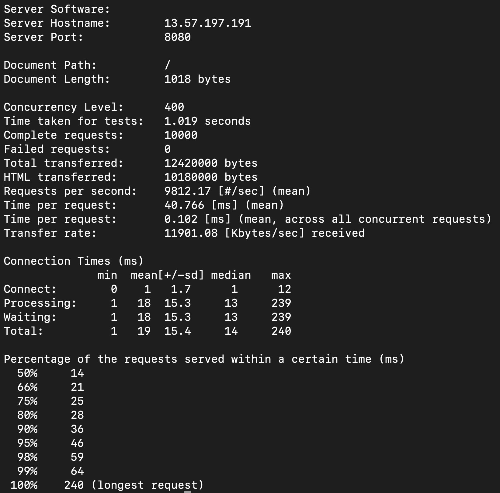
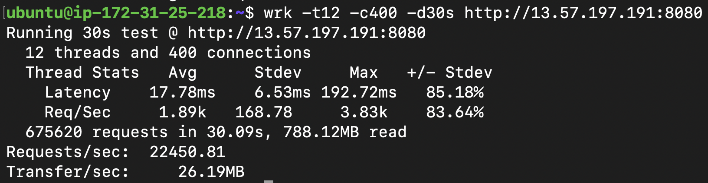
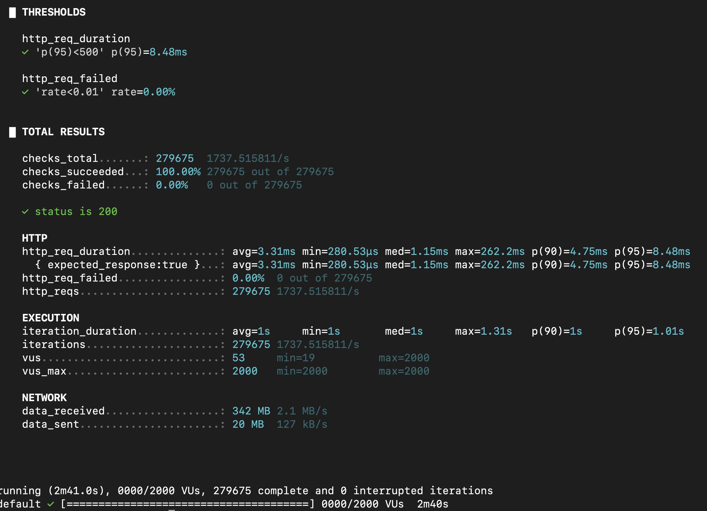
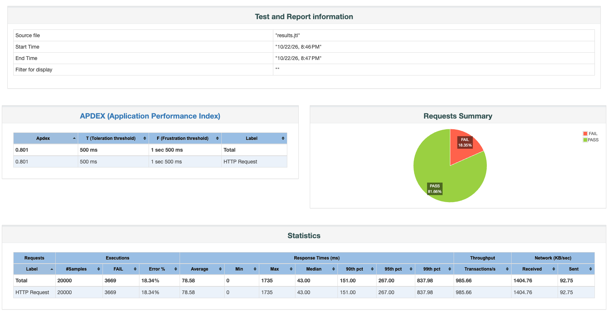

# Benchmarking
Benchmarking the API server for throughput, latency and errors.

There are multiple tools for this purpose. Out of which the popular ones are JMeter, Wrk, Apache Benchmark.

Benching is done by writing a small GET api which returns a small string and deployed to ml.t3.micro on aws instance. Traffic is generated by using different ml.t3.micro instance. 

## Apache Bench
```ab -n 10000 -c 400 00.00.00.00:0000/```



## Wrk
```wrk -t12 -c400 -d30s http://00.00.00.00:0000```


## K6
```javascript
import http from 'k6/http';
import { check, sleep } from 'k6';

// 1. Configure the load test stages
export const options = {
  stages: [
    { duration: '30s', target: 2000 }, // Ramp up to 20 virtual users over 30 seconds
    { duration: '2m', target: 2000 },  // Stay at 20 virtual users for 1 minute (sustain load)
    { duration: '10s', target: 0 },  // Ramp down to 0 users over 10 seconds
  ],
  thresholds: {
    http_req_failed: ['rate<0.01'], // Failed requests must be less than 1%
    http_req_duration: ['p(95)<500'], // 95% of requests must finish under 500ms
  },
};

// 2. Define the test logic
export default function () {
  // Replace with your actual GET API endpoint URL
  const url = 'http://00.00.00.00:00'; 
  
  const response = http.get(url);

  // 3. Validate the response status and content
  check(response, {
    'status is 200': (r) => r.status === 200
  });

  // Pacing: Wait 1 second between iterations per virtual user
  sleep(1);
}
```


## JMeter

